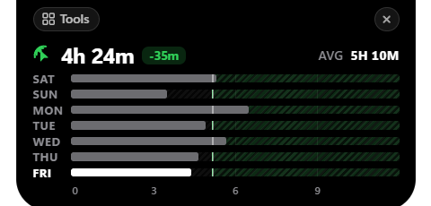
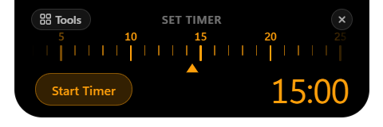

<p align="center">
  <a href="https://github.com/Keerthanreddy01/Islet">
    
  </a>
</p>

<h1 align="center">Islet</h1>

<p align="center">
  <b>A sleek, fluid Dynamic Island for Windows desktops.</b><br />
  Keep your media, AI developer agent tasks, productivity tools, and system metrics at your fingertips in one calm, floating capsule.
</p>

<p align="center">
  <a href="https://github.com/Keerthanreddy01/Islet/releases/tag/v0.1.0"></a>
  <a href="https://github.com/Keerthanreddy01/Islet/releases/download/v0.1.0/Islet-Setup-0.1.0-x64.exe"></a>
  <a href="https://github.com/Keerthanreddy01/Islet/actions/workflows/ci.yml"></a>
  
  
  
  <a href="LICENSE"></a>
</p>

---

## 🌟 Overview

**Islet** brings the intuitive **Dynamic Island** concept to Windows 10 and Windows 11. Anchored smoothly at the top center of your display, Islet morphs effortlessly between a minimal ambient capsule and an expanded control center using physics-based spring easing.

Designed for frictionless multitasking, Islet lets you glance at real-time media playback, monitor autonomous AI developer agent sessions, scrub through precision countdown timers, track daily screen time, and stash temporary scratch clips—without disrupting your active workspace.

---

## 📸 Product Preview

### Minimal Ambient Capsule (Collapsed Mode)
*Discreet, click-through ambient status anchored to the top of your screen:*

| Idle Clock & Ambient Weather | Live Spotify Now-Playing |
|:---:|:---:|
|  |  |

### Expanded Control Center
*Fluidly expands on hover or click to reveal interactive widgets and tools:*

#### Quick Tools & Workflow Action Bar
<p align="center">
  <br />
  <em>Quick-access navigation bar for media controls, timer dial, screen time radar, and saved files shelf.</em>
</p>

#### Weekly Screen Time Radar
<p align="center">
  <br />
  <em>Daily and 7-day weekly device activity breakdown, active uptime, and usage averages.</em>
</p>

#### Precision Rotary Timer Dial
<p align="center">
  <br />
  <em>Apple-inspired rotary ruler dial for frictionless minute adjustments and instant countdowns.</em>
</p>

---

## ✨ Key Features

### 🎵 Universal Media Hub
- **Native Windows GSMTC Sync:** Seamless real-time tracking supporting **Spotify**, **YouTube**, **Apple Music**, **Brave**, **Chrome**, **VLC**, and other Windows media sessions.
- **High-Res Artwork Resolver:** Smart album art discovery with local memory and disk caching via the isolated `islet-art:` protocol.
- **Micro-Equalizer Animations:** Visualizer feedback responsive to current playback status.

### 🤖 Developer AI Agent Activity Monitor
- **Ambient Session Tracking:** Live status indicators for **Google Antigravity**, **Claude Code**, and **OpenAI Codex**.
- **Live Tool Introspection:** Real-time visibility into agent actions (e.g., `Editing App.tsx`, `Running tests`, `Browsing documentation`).
- **⇄ Dual-Activity Multitasking:** Swap primary and secondary focus between background music and running AI agents with a single click.

### ⏱ Precision Rotary Timer Dial
- Smooth rotary ruler dial with snappy spring physics for fast minute timer configuration.
- Mouse wheel, drag, and tap interactions with audio-haptic feedback.

### 📊 Screen Time & Productivity Radar
- Real-time device active uptime tracker powered by native background PowerShell workers.
- Complete 7-day weekly activity visualization and average screen hours.

### 📋 Saved Files & Clipboard Shelf
- **Capacity-Controlled:** Strict 6-image maximum limit across file browsing, drag-and-drop, and global `Ctrl+V` clipboard pastes.
- **Compact Horizontal Gallery:** Uniform 80×80px cards with smooth 4px scrollbar and mouse wheel scroll-forwarding.
- **Native OS Interactions:** One-click clipboard copy (`shelf:copy-image`), individual deletion, and native file drag-out (`shelf:start-drag`) into File Explorer or browser tabs.

### 🛡 Engineered for Security & Performance
- **Electron 45.1.0 Runtime:** Modern Chromium 156 and Node 24 architecture with zero known runtime advisories.
- **Context Isolation & Strict CSP:** No nodeIntegration in renderer; typed preload API boundary via `contextBridge`.
- **Navigation Lockdown:** All child windows denied by default; outbound HTTP/HTTPS links delegate exclusively to your default browser.
- **Layered Window Click-Through:** Native Windows `setIgnoreMouseEvents(true, { forward: true })` ensures transparent window regions pass all mouse clicks through to underlying applications.

---

## 📥 Download & Installation

### Option 1: Official Windows Installer (Recommended)

1. Download the latest setup executable from the [GitHub Releases](https://github.com/Keerthanreddy01/Islet/releases/latest) page:
   - **Installer:** [`Islet-Setup-0.1.0-x64.exe`](https://github.com/Keerthanreddy01/Islet/releases/download/v0.1.0/Islet-Setup-0.1.0-x64.exe) (~112 MB)
2. Run the installer wizard. Choose your preferred destination directory and desktop/startup shortcut options.
3. *Note for Early Access:* Because Islet is an independent open-source binary without an expensive commercial code-signing certificate, Windows Defender SmartScreen may display an *"Unrecognized app"* prompt on initial launch. Click **"More info"** → **"Run anyway"** to proceed.

---

## 🛠 Development & Building from Source

### Prerequisites
- **Windows 10 (version 1903+) or Windows 11** (64-bit)
- **Node.js** v20.x or v22.x (LTS recommended)
- **npm** v9 or higher
- **PowerShell** 5.1+ (included natively with Windows)

### 1. Clone & Install
```powershell
# Clone the repository
git clone https://github.com/Keerthanreddy01/Islet.git
cd Islet

# Install dependencies
npm ci
```

### 2. Run in Development Mode
```powershell
npm run dev
```
*Launches the Vite development server on `127.0.0.1:5173` with live Hot Module Replacement (HMR) and mounts the Electron desktop capsule.*

### 3. Verify & Lint
```powershell
npm run lint
```
*Runs strict TypeScript type-checking across both the React renderer (`tsconfig.json`) and the Electron main process (`tsconfig.electron.json`).*

### 4. Build Production Bundle
```powershell
npm run build
```

### 5. Package Windows NSIS Installer
```powershell
npm run dist
```
*Generates the production-ready installer executable in the `release/` directory.*

---

## 🤝 Contributing

We warmly welcome contributions from the community! Whether you are fixing bugs, improving documentation, or proposing new widgets:

1. Read our [Contributing Guidelines](CONTRIBUTING.md) for branch naming, coding standards, and PR workflows.
2. Review our [Code of Conduct](CODE_OF_CONDUCT.md).
3. Check our [Security Policy](SECURITY.md) for responsible vulnerability disclosure.

---

## 📄 License

This project is open-source and licensed under the **[MIT License](LICENSE)**.

Copyright © 2026 [Keerthan Reddy](https://github.com/Keerthanreddy01).
